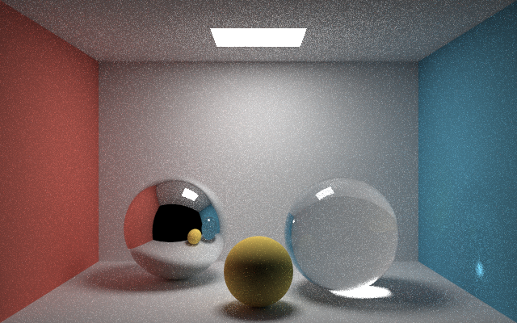
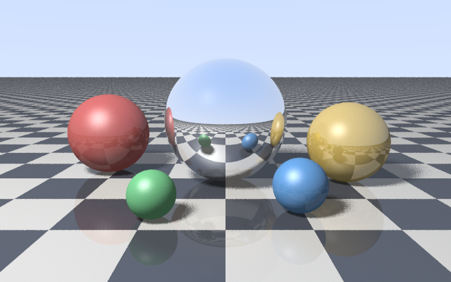
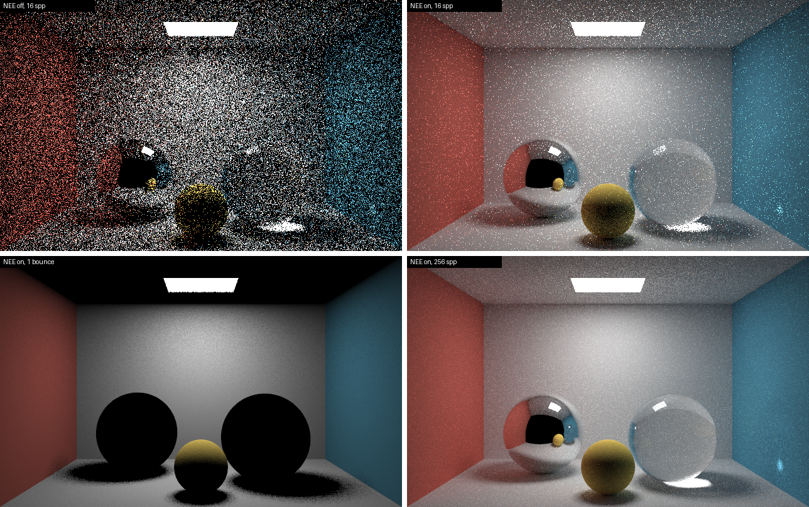
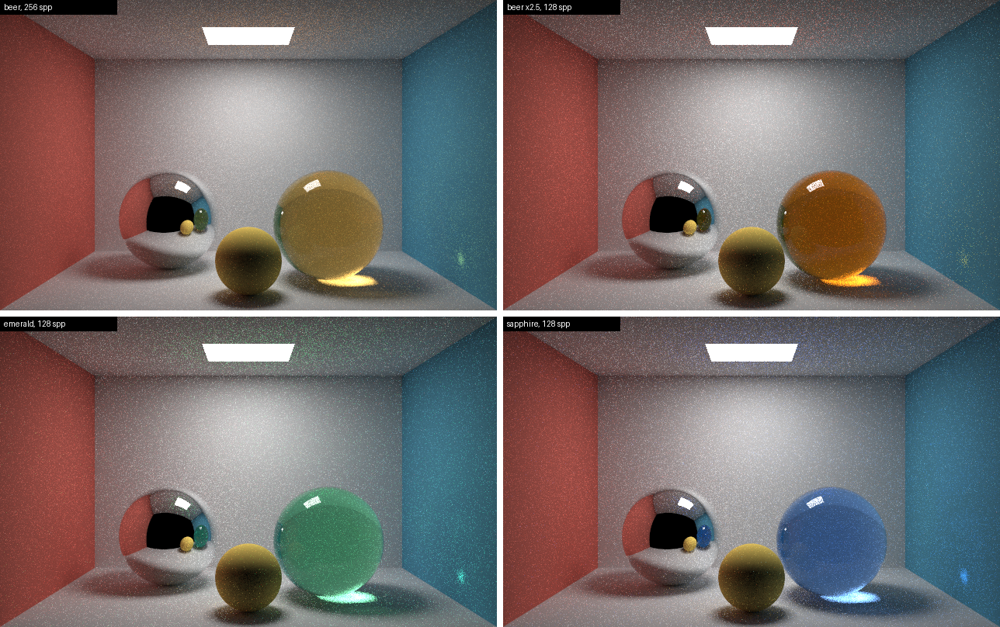
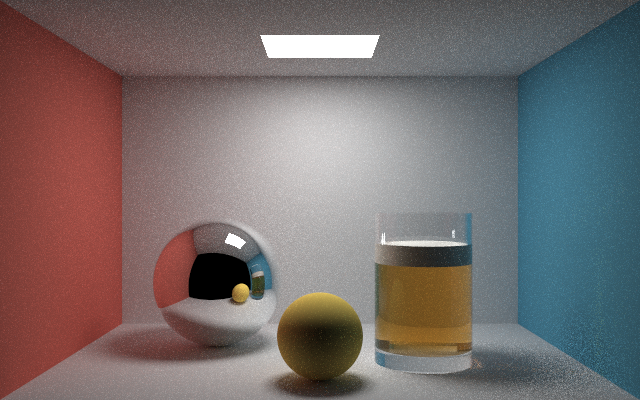

# scalajs-wasm-module-exercise

Scala.js 1.23.0 で入った `ModuleKind.WasmModule` を、いろいろ試した記録です。

`WasmModule` でリンクすると、JS の接着コードを一切含まない素の `main.wasm` が出力されます。そのため、ブラウザや Node.js だけでなく、wasmtime のような JS 以外のホストでも動きます。



## 中身

| 場所 | 内容 |
|---|---|
| `src/main/scala/` | 最初の実験 (`Hello`、境界を越えられる型の調査、文字列の受け渡し、ベンチマーク) |
| `src/main/scala/img/` | 画像生成と物理シミュレーション。レイトレーサー、ジュリア集合、PNG エンコーダー (Deflate も自作)、2 次元流体 (Stable Fluids)、パストレーサー (色付きガラス、ビールを注いだグラス)、自前の数学関数 |
| `web/` | ブラウザ用の窓口。`img/` を共有し、インポートのないモジュールを作る |
| `scheme/` | Scheme 処理系 (末尾呼び出しの最適化、多倍長整数、準クォート、ステップ数の上限つき) |
| `hosts/node/` | Node.js から `.wasm` を読み込んで動かすスクリプト |
| `hosts/python/` | wasmtime (Python バインディング) から動かすスクリプト |
| `pages/renderer/` | レイトレーサー、ジュリア集合、流体、パストレーシングをブラウザで動かすページ |
| `pages/scheme/` | Scheme の REPL ページ |
| `audio/` | インパルス応答の畳み込みエフェクター (FFT 畳み込み、残響や電話のインパルス応答の合成) |
| `pages/convolver/` | エフェクターのページ |
| `experiments/scala3-mixed/` | ロジックを Scala 3 で、Wasm との境界だけを Scala 2.13 で書く構成 |

## 必要なもの

- JDK 21、sbt 1.11
- Node.js 22 以降 (手元では v22.23.5 で動作を確認)
- ブラウザで見る場合は、Wasm GC と例外処理に対応したもの
- wasmtime で試す場合は Python 3 と `hosts/python/requirements.txt`

## 動かし方

```sh
# 実験用モジュール
sbt root/fullLinkJS
node hosts/node/run.mjs   target/scala-2.13/sjs-wasm-play-opt/main.wasm
node hosts/node/types.mjs target/scala-2.13/sjs-wasm-play-opt/main.wasm
node hosts/node/demo.mjs  target/scala-2.13/sjs-wasm-play-opt/main.wasm
mkdir -p out && node hosts/node/image.mjs target/scala-2.13/sjs-wasm-play-opt/main.wasm out

# ブラウザ用ページ (.wasm をビルドして pages/ に置く)
./scripts/build-pages.sh
python3 -m http.server -d pages 8000   # http://localhost:8000/renderer/ と /scheme/

# wasmtime から
python3 -m venv .venv && .venv/bin/pip install -r hosts/python/requirements.txt
.venv/bin/python hosts/python/demo_wasmtime.py   target/scala-2.13/sjs-wasm-play-opt/main.wasm
.venv/bin/python hosts/python/scheme_wasmtime.py pages/scheme/main.wasm
```

## わかったこと

### 1. 設定

```scala
scalaJSLinkerConfig := {
  scalaJSLinkerConfig.value
    .withESFeatures(_.withUseWebAssembly(true))
    .withModuleKind(ModuleKind.WasmModule)
}
```

- `withExperimentalUseWebAssembly` は 1.22 から非推奨。
- Scala 2.13 で使う場合は、2.13.18 以降が必要 (scala-library 2.13.18 が依存に入るため)。

### 2. Scala 3 ではまだ使えない (2026-11-18 時点)

Scala 3 は Scala.js のバックエンドをコンパイラ本体に同梱している。同梱されている IR のバージョンは次のとおりで、どれも `@WasmExport` / `@WasmImport` を処理しない。

| コンパイラ | 同梱されている Scala.js IR |
|---|---|
| Scala 3.3.7 | 1.12 |
| Scala 3.10.1 | 1.22 |
| 3.10.2-RC1 nightly (2026-11-15) | 1.22 |
| scalajs-compiler 1.23.0 (Scala 2 用プラグイン) | 1.23 |

未対応のコンパイラはアノテーションを黙って無視する。エクスポートが 1 つもない扱いになるので、**エラーも警告も出ずに出力が空になる**。

回避策として、ロジックを Scala 3、境界だけを Scala 2.13 (`-Ytasty-reader`) で書く構成なら動く (`experiments/scala3-mixed/`)。ただし Scala 3.8 以降は標準ライブラリが `scala-library 3.x` になるため、この構成で使える Scala 3 は 3.7 系まで。

### 3. 境界を越えられる型

| Scala | Wasm |
|---|---|
| `Int` / `Long` / `Float` / `Double` | `i32` / `i64` / `f32` / `f64` |
| `Array[Byte/Short/Int/Long/Float/Double]` | `(ref (array (mut i8/i16/i32/i64/f32/f64)))` |
| `Unit` | 戻り値なし (戻り値の型としてのみ) |

- `Boolean`、`Char`、単体の `Byte`、`String` はコンパイルエラーになる。
- **配列は境界を越えるたびにコピーされる** (Scaladoc にも明記されている)。ホストが配列を書き換えても Scala 側には届かず、同じ配列を 2 回返すと別のオブジェクトになる。
- JS から見ると配列の中身は読めない (`.length` も添字アクセスも使えない)。
- そのため、バッファは Scala 側に持ち、境界はスカラー値だけでやり取りするのが実用的だった (`inPush(b)` / `outAt(i)` のような形)。25 万画素を `px(i)` で 1 つずつ読んでも数ミリ秒だった。

### 4. リンクできるもの・できないもの

| リンクできる | リンクエラーになる |
|---|---|
| `Math.sqrt`、`floor`、`abs`、`min` | `Math.sin`、`cos`、`tan`、`pow`、`exp`、`log`、`atan2`、`round` |
| `String.toDouble`、`Double.toString`、`BigInt`、`format`、`mutable.HashMap` | `println` (`System.out`)、正規表現、`java.util.stream` |

`sin`、`cos`、`exp`、`log`、`pow` は `img/MathX.scala` で自前実装した。JS の `Math` と比べた相対誤差は最大でも 10⁻¹³ 程度。

### 5. 決定的に動く

同じシードなら、Node.js (V8) と wasmtime (Cranelift) でレイトレーサーの PNG がバイト単位で一致した。流体シミュレーションの運動エネルギーも一致した。

### 6. 性能は V8 と wasmtime で傾向が違う

2,000 万回ループのマイクロベンチマーク (`src/main/scala/Bench.scala`):

| | Node.js (V8) | wasmtime 50 |
|---|---|---|
| 演算のみ | 59 ms | 37 ms |
| GC 配列の読み書き | 53 ms | 124 ms |
| 毎回オブジェクトを確保 | 340 ms | 5,502 ms |

実際のプログラムでも同じ傾向が出た。

| プログラム | Node.js | wasmtime | 比 |
|---|---|---|---|
| ジュリア集合 (ほぼ演算のみ) | 0.26 s | 0.57 s | 2.2 倍 |
| 流体 1 ステップ (配列中心、確保なし) | 9.9 ms | 29.8 ms | 3 倍 |
| レイトレーサー (ケースクラスを大量に確保) | 1.8 s | 33 s | 18 倍 |
| Scheme の `(fib 25)` (インタプリタ) | 0.18 s | 4.6 s | 26 倍 |

JS 以外のホストで重い処理を回すなら、ホットループでオブジェクトを作らない書き方が効く。

### 7. Wasm 関数のローカル変数がスタックの深さを決める

Scheme の評価器で、特殊形式を全部 1 つの巨大な `match` に書いていたときは、末尾位置でない再帰が 1,000〜2,000 段で溢れた。`eval` を細いループにして、特殊形式を別メソッドに分けたら、約 5,700 段まで伸びて、速度も 2 割上がった。

スタックが溢れると JS の `RangeError` になり、Scala の例外としては捕まえられない。ただし、そのあともインスタンスは使い続けられた。

### 8. 試せなかったこと

`withExperimentalUseCustomDescriptors(true)` は、手元の Node.js 22 も wasmtime 50 も未対応で、読み込めなかった。

## 画像

| | |
|---|---|
|  |  |

パストレーシングでの NEE (光源の直接サンプリング) と跳ね返り回数の比較:



色付きガラス。ガラスの中を通った距離に応じて、色ごとに `exp(-σ·距離)` の割合で吸収する (ランベルト・ベールの法則)。縁は淡く中心は濃くなり、床に落ちるコースティクスも同じ色に染まる。



ビールを注いだグラス (512 サンプル/画素)。グラスは円柱と円板の面の集まりで、面ごとに表と裏の媒質 (空気・ガラス・ビール) を決めてある。光線が面に当たったときに、法線との向きだけで「どの媒質から、どの媒質へ」進むかがわかるので、ガラスからビールへ (屈折率 1.5 → 1.33) のような屈折もそのまま計算できる。

泡はガラス越しに見る側面だけ、光源を狙うときにグラスの壁を「屈折を無視して素通りできる薄いガラス」とみなしている (近似)。これを入れないと、泡の側面は偶然光源に当たる経路でしか照らされず、灰色にざらついた。



流体シミュレーションの時間変化 (60 / 150 / 300 ステップ):


